# System Architecture & Technical Design: DEEN Commerce Reconciliation Engine

**Version:** 2.4.0  
**Stack:** Next.js 14.2 (App Router) · React 18 · TypeScript 5.6 · Tailwind CSS 3.4 · AlaSQL 4.21 · SheetJS (XLSX) · Google GenAI SDK (`@google/genai`)  
**Architecture Pattern:** Client-First Hybrid Analytic Engine with Serverless Ingestion Edge  
**Last Updated:** November 2026  

---

## 1. Architectural Philosophy & Design Principles

The **DEEN Commerce Reconciliation Engine** is architected to solve a critical enterprise problem: **financial and inventory uncertainty in omnichannel parcel delivery logistics**.

### Core Tenets:
1. **Zero-Latency In-Browser OLAP Engine**: High-volume tabular analysis, sorting, filtering, and cross-tabulations occur entirely in-memory in the client browser using AlaSQL and optimized TypeScript data structures. Users experience 0ms UI lag across 50,000+ line items.
2. **Mathematical Determinism (Integer Knapsack)**: Partial returns and multi-item dispatches are resolved via deterministic dynamic programming (subset-sum 0/1 knapsack). Floating-point quantities (e.g. `0.5 shirts`) are mathematically disallowed.
3. **Omnichannel Domain Isolation**:
   - Central Warehouse Online Orders (`isOrderOnline: true`, `isPos: false`)
   - Branch Courier Dispatches (`17263 c`, `17263 w`, `17263 s`, `17263 m`)
   - Retail Walk-In POS Orders (`_sip_outlet_id`: `2`, `7`, `8`, `9`; `isPos: true`, `isOrderOnline: false`)
   - Size Exchange Replacements (`D-17263`, `DD-17263`)
4. **Unbreakable Layout Contract**: Strict layout isolation ensures responsive tables never overflow or break viewport boundaries regardless of screen width or browser scaling.

---

## 2. High-Level System Architecture Diagram

```mermaid
flowchart TD
    subgraph Data Sources
        WC["WooCommerce REST API v3\n(Orders, Line Items, POS)"]
        PH["Pathao Hermes API\n(Consignments, COD, Surcharges)"]
        WB["Incoming Webhooks\n(Order updates, Status hooks)"]
        CSV["Manual Courier Reports\n(Excel / CSV Dropzone)"]
    end

    subgraph Serverless Edge Layer [Next.js 14 App Router API Layer]
        API_WC["/api/sync/woocommerce"]
        API_PH["/api/sync/pathao"]
        API_ST["/api/sync/status"]
        API_CP["/api/campaigns"]
        API_SD["/api/sample-data"]
        EVENT_HUB["Webhook Log Store\n(src/data/sync-events.jsonl)"]
    end

    subgraph Client Engine [Client-Side Browser Runtime]
        subgraph Ingestion & State
            CACHE["IndexedDB + LocalStorage Cache"]
            SET_STORE["settingsStore.ts\n(Theme, Presets, API Keys)"]
            OVR_STORE["overrideStore.ts\n(Manual Status Overrides)"]
            CMP_STORE["campaignStore.ts\n(Marketing Ad Spend & ROI)"]
        end

        subgraph Analytic Core [src/lib/]
            DP["Knapsack DP Solver\n(subsetSum.ts)"]
            RECON["Reconciliation Engine\n(reconciliationEngine.ts)"]
            ALASQL["AlaSQL In-Memory Database"]
            AUDIT["Discrepancy Auditor\n(discrepancyAuditor.ts)"]
            GEO["Geo & Territory Classifier\n(geo.ts)"]
            XLSX["SheetJS Export Engine\n(excelExport.ts)"]
            THEME["Theme Dynamic Manager\n(themeManager.ts)"]
            AI["Semantic Copilot Engine\n(@google/genai 2.29)"]
        end

        subgraph Presentation Views [src/components/tabs/]
            TAB_EXEC["Executive Overview Tab"]
            TAB_OPS["Live Ops Terminal Tab"]
            TAB_DISP["Outlet Dispatch Tab"]
            TAB_SALES["Outlet Sales Tab (POS vs Web)"]
            TAB_MATRIX["Status Matrix Tab"]
            TAB_SKU["SKU Performance Tab"]
            TAB_RET["Item Returns Tab"]
            TAB_MISMATCH["Courier Mismatch Tab"]
            TAB_TERR["Territory Breakdown Tab"]
            TAB_RISK["Customer Risk Scoring Tab"]
            TAB_UNIT["Unit Economics Tab"]
            TAB_EXCH["Exchanged Orders Hub"]
            TAB_LEDGER["Orders Ledger Tab"]
            TAB_STMT["Monthly Statements Hub"]
            TAB_CAMP["Campaign Intelligence Tab"]
            TAB_SET["Settings & Theme Manager Tab"]
        end
    end

    WC --> API_WC
    PH --> API_PH
    WB --> EVENT_HUB
    EVENT_HUB --> API_WC
    CSV --> CACHE

    API_WC --> CACHE
    API_PH --> CACHE
    API_SD --> CACHE
    API_CP --> CMP_STORE

    CACHE --> RECON
    RECON --> DP
    RECON --> AUDIT
    RECON --> GEO
    RECON --> ALASQL

    ALASQL --> TAB_EXEC
    ALASQL --> TAB_OPS
    ALASQL --> TAB_DISP
    ALASQL --> TAB_SALES
    ALASQL --> TAB_MATRIX
    ALASQL --> TAB_SKU
    ALASQL --> TAB_RET
    ALASQL --> TAB_MISMATCH
    ALASQL --> TAB_TERR
    ALASQL --> TAB_RISK
    ALASQL --> TAB_UNIT
    ALASQL --> TAB_EXCH
    ALASQL --> TAB_LEDGER
    ALASQL --> TAB_STMT
    CMP_STORE --> TAB_CAMP
    SET_STORE --> THEME
    THEME --> TAB_SET
    RECON --> XLSX
    ALASQL --> AI
```



---

## 3. Directory & Codebase Structure

```
D:\Repo\DEEN Sales Analysis\
├── .agents/                    # Agent behavioral rules & guidelines
│   └── rules/                  # Specific modular rules (CSS, Order, Reconciliation)
├── docs/                       # Comprehensive documentation suite (All 23 specs)
├── public/                     # Static assets, branding logos & favicons
├── scripts/                    # Automation scripts (Multi-month dataset generators, baseline builders)
│   ├── build_unified_baseline.ts
│   ├── fetch_november_orders.ts
│   ├── generate_multi_month_workbook.ts
│   ├── test_nov_orders.ts
│   └── test_sept_orders.ts
├── src/
│   ├── app/                    # Next.js 14 App Router
│   │   ├── api/                # Serverless edge API routes (sync, campaigns, sample-data)
│   │   ├── globals.css         # Unbreakable base styles & CSS variables
│   │   ├── layout.tsx          # Root HTML layout with inline theme variable injection
│   │   └── page.tsx            # Master single-page app containing all 16 tab modules
│   ├── components/             # React presentation components
│   │   ├── common/             # Shared atomic widgets (Badges, Metric cards, MonthlyStatementsHub)
│   │   ├── tabs/               # 16 specialized analytical modules
│   │   ├── Header.tsx          # Header with omni search, AI Ask button & Command palette
│   │   ├── KpiOverview.tsx     # Hero KPI cards with unbreakable mini-donuts
│   │   └── Sidebar.tsx         # Responsive collapsible navigation
│   ├── data/                   # Seed files, offline baselines & webhook event logs
│   ├── lib/                    # Core algorithms and calculation services
│   │   ├── ai/                 # Gemini prompt templates, semantic query parser & knowledge base
│   │   ├── campaignEngine.ts   # Marketing attribution & ROAS mathematics
│   │   ├── campaignStore.ts    # Ad spend local persistence
│   │   ├── dateFilter.ts       # Unified industry-standard date range filters
│   │   ├── discrepancyAuditor.ts # Courier fee and COD discrepancy detector
│   │   ├── excelExport.ts      # Multi-sheet audit-grade SheetJS export generator
│   │   ├── monthlyStatements.ts# September, October, November statement consolidator
│   │   ├── overrideStore.ts    # Manual reconciliation status overrides
│   │   ├── reconciliationEngine.ts # Primary order-courier matching engine
│   │   ├── settingsStore.ts    # User settings, API keys, credentials & preferences
│   │   ├── subsetSum.ts        # 0/1 knapsack dynamic programming algorithm
│   │   └── themeManager.ts     # Native Super White & preset background controller
│   └── types/                  # TypeScript interface contracts (Order, LineItem, Campaign)
└── tests/                      # Automated Vitest suites (Knapsack math, campaigns, statements)
```

---

## 4. Key Subsystem Architectures

### 4.1 Knapsack Dynamic Programming Reconciliation Subsystem
- **Problem**: When Pathao collects partial COD on an order containing $N$ distinct items with prices $[p_1, p_2, \dots, p_N]$, determine which combination of items was delivered vs returned.
- **Algorithm**:
  1. Let $C_{collected}$ be the net collected cash from the courier report.
  2. Compute Net Items Value: $V = C_{collected} - \text{Fee}_{shipping}$, where shipping fee is ৳50 (Inside Dhaka) or ৳90 (Outside Dhaka).
  3. Dynamic programming state $DP[i][w]$ represents whether an exact cash value $w$ can be formed using a subset of the first $i$ items.
  4. Backtrack to reconstruct the delivered item set $S_{delivered}$ and returned set $S_{returned} = S_{all} \setminus S_{delivered}$.
  5. Enforce integer constraint: Quantity per line item must be $\in \mathbb{Z}^+$.

### 4.2 Multi-Layer Cache & Partitioned Month Store
1. **L1 In-Memory State**: React state (`useState`, `useMemo`) and in-browser AlaSQL database tables for instant UI re-renders and sub-5ms filter-wise slicing across 15,000+ rows.
2. **L2 Local Storage**: Key-value settings (`settingsStore.ts`), theme overrides (`themeManager.ts`), and operator session tokens.
3. **L3 Partitioned Month Store (IndexedDB)**: `deen_partition_orders_YYYY_MM` partitioned monthly lakehouse. Historical closed months (e.g. September, October) enjoy an adaptive 30-day/indefinite TTL, enabling instant 0ms restoration without making any external API requests.
4. **Non-Destructive Upsert Merger (`src/lib/sync/partitionStore.ts`)**: When on-demand date ranges or live webhooks arrive, orders are merged by primary key (`orderId`), preserving historical months and updating statuses in place without duplicating records.
5. **Full Specification Reference**: See [docs/DATA_SYNC_AND_PARTITIONING.md](file:///d:/Repo/DEEN%20Sales%20Analysis/docs/DATA_SYNC_AND_PARTITIONING.md).

### 4.3 Native Super White & Dynamic CSS Architecture
- The application defaults to **Native Super White** (`#FFFFFF`) to mimic native macOS/Windows desktop enterprise applications.
- CSS variables injected onto `:root`:
  - `--bg-surface`: `#FFFFFF`
  - `--sidebar-surface`: `#FFFFFF`
  - `--card-surface`: `#FFFFFF`
  - `--border-surface`: `#E5E7EB`
  - `--text-surface`: `#0F172A`
- Theme switcher supports 5 instant presets: Native Super White, Modern Slate (`#F8FAFC`), Cool Metallic Zinc (`#F4F4F5`), Warm Paper Ivory (`#FAFAF9`), and Deep Midnight Canvas (`#0B0F19`).

---

## 5. Security & Isolation Boundaries

- **No Secrets in Client Bundles**: Next.js App Router API routes strictly shield `WOOCOMMERCE_CONSUMER_SECRET` and `PATHAO_CLIENT_SECRET`. Only sanitized public payloads are streamed to the browser.
- **HMAC Verification**: Webhooks verify incoming cryptographic signatures before writing events.
- **Strict Role Boundaries**:
  - `Executive Director`: Full view across all financial metrics, profit margins, and export triggers.
  - `Branch Operator`: Scoped exclusively to assigned outlet (`_sip_outlet_id`).
  - `Auditor`: Read-only access to reconciliation discrepancy logs.
