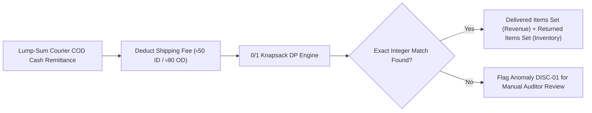

# Research & Development (R&D) Roadmap: DEEN Commerce

**Version:** 2.4.0  
**Research Unit:** DEEN Commerce Algorithmic & AI Logistics Lab  
**Focus Areas:** Combinatorial Reconciliation · Predictive RTO Classifiers · Semantic Copilot Agents  
**Last Updated:** November 2026  

---

## 1. Executive Mission & R&D Mandate

The **DEEN Commerce R&D Roadmap** focuses on solving high-complexity mathematical, logistical, and computational challenges unique to omnichannel apparel e-commerce in South Asia. 

Our core research mandate is to replace manual human inspection and guesswork with **mathematically deterministic algorithms**, **machine learning fraud predictors**, and **autonomous conversational agents**.

---

## 2. Active Research Initiatives & Innovations

### 2.1 Combinatorial Knapsack Optimization (`subsetSum.ts`)
- **Status:** In Production (v2.2+)
- **Problem:** When an order contains $k$ line items and a courier collects a partial cash amount $V_{net}$, determine the exact subset of items delivered.
- **Complexity:** $O(k \cdot V_{net})$ pseudo-polynomial time dynamic programming.
- **Active Exploration:**
  - Branch-and-bound pruning for large gift basket orders ($k > 15$).
  - Heuristic tie-breaking when two distinct combinations yield identical sums (e.g., factoring customer sizing history or return affinity).
  - Floating-point prevention: Guaranteed integer output vector $\mathbf{x} \in \{0, 1\}^k$.



---

### 2.2 Predictive RTO Machine Learning Classifier (Pre-Dispatch Risk)
- **Status:** Experimental Prototype (R&D Stage 2)
- **Problem:** Once a high-risk parcel is handed to the courier, the merchant is guaranteed to incur ৳75 to ৳135 in sunk logistics fees if the customer rejects it.
- **Proposed Architecture:**
  - Gradient Boosted Trees (XGBoost / LightGBM) trained on historical order vectors:
    - Customer historical Pathao delivery success rate ($P_{success} \in [0, 1]$).
    - Delivery Territory (Inside Dhaka vs Outside Dhaka).
    - Basket complexity (number of items, presence of duplicate sizes).
    - Payment method (COD vs advance bKash).
    - Time of placement (e.g. late night impulse orders).
- **Target Output:** Pre-dispatch RTO Risk Score ($R \in [0, 100]$).
  - $R > 75$: Triggers automated SMS/WhatsApp order re-confirmation flow before warehouse packing.

---

### 2.3 Gemini 2.5 Semantic Analytics Copilot
- **Status:** In Production (v2.4+) via `@google/genai` (v2.29.1)
- **Architecture:**
  1. User enters natural language query: *"Which branch had the highest courier fee leakage in October?"*
  2. Gemini 2.5 Flash parses the prompt against our structured schema in `src/lib/ai/prompts.ts`.
  3. Synthesizes an optimized AlaSQL query executed in-browser against active memory tables.
  4. Returns executive plain-English summary alongside clickable data table filters.
- **Future R&D Exploration:** Autonomous closed-loop reconciliation agents capable of auto-filing carrier disputes without human intervention.

---

### 2.4 RFID & Computer Vision Warehouse Intake
- **Status:** Conceptual Exploration (Q2 2027)
- **Concept:** Overhead camera with high-speed barcode and optical character recognition (OCR) scanning returned polybags on the conveyor, instantly querying `/api/sync/pathao` and updating `LiveOpsTab` in $<300\text{ms}$.

---

## 3. R&D Milestone Trajectory

```
Q3 2026 (Completed)   │ Knapsack 0/1 Subset Sum DP Algorithm
                      │ Integer-Only Quantity Guarantee
──────────────────────┼─────────────────────────────────────────────
Q4 2026 (Current)     │ Gemini 2.5 Flash Copilot Integration
                      │ Multi-Month Trajectory Statements
                      │ Campaign Intelligence & Delivered ROAS Engine
──────────────────────┼─────────────────────────────────────────────
Q1 2027 (Planned)     │ Production Predictive RTO ML Model
                      │ Pre-Dispatch WhatsApp Confirmation Bot
                      │ Steadfast & RedX Multi-Courier Integration
──────────────────────┼─────────────────────────────────────────────
Q2 2027 (Future)      │ Automated Courier Dispute API Auto-Claim
                      │ Real-time Store POS RFID Handover
```
