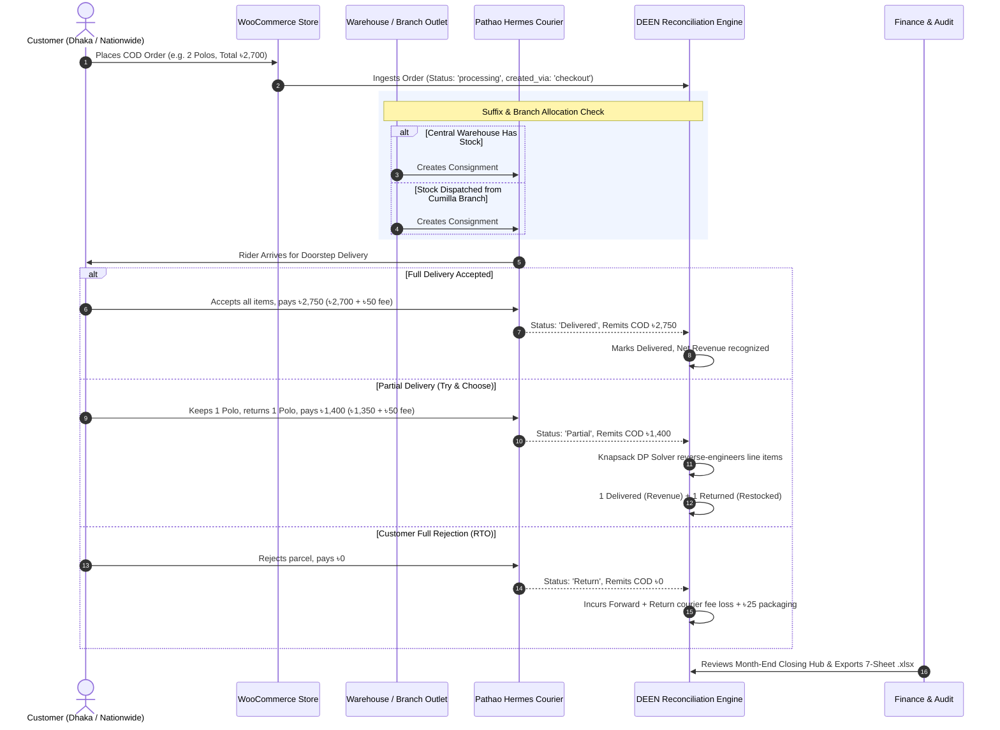

# Engineering & Operational Workflows: DEEN Commerce

**Version:** 2.4.0  
**Scope:** Order Lifecycle Pipeline · Engineering SDLC · Incident Escalation  
**Last Updated:** November 2026  

---

## 1. End-to-End Order Lifecycle & Reconciliation Workflow



---

## 2. Developer Software Development Lifecycle (SDLC) Workflow

All engineers and autonomous coding assistants must follow this 6-step lifecycle:

```
┌────────────────────────────────────────────────────────────────────────┐
│                   DEEN DEVELOPER SDLC WORKFLOW                         │
├────┬───────────────────────────┬───────────────────────────────────────┤
│ 1  │ Local Environment Setup   │ npm install                           │
│    │                           │ cp .env.example .env.local            │
│    │                           │ npm run dev (runs on port 3000)       │
├────┼───────────────────────────┼───────────────────────────────────────┤
│ 2  │ Feature Implementation    │ Create feature branch: feat/xxx       │
│    │                           │ Follow 10 Golden UX Rules in DESIGN.md│
│    │                           │ Ensure integer knapsack invariants    │
├────┼───────────────────────────┼───────────────────────────────────────┤
│ 3  │ Quality Gate Verification │ npm run type-check (tsc --noEmit)     │
│    │                           │ npm run lint                          │
│    │                           │ npm test (Vitest test suites)         │
├────┼───────────────────────────┼───────────────────────────────────────┤
│ 4  │ Responsive Validation     │ Test at 375px, 768px, 1440px, 1920px  │
│    │                           │ Verify SVG clamping (max 44x44px)     │
├────┼───────────────────────────┼───────────────────────────────────────┤
│ 5  │ Pull Request & CI/CD      │ Commit using Conventional Commits     │
│    │                           │ Push to GitHub; Vercel generates      │
│    │                           │ live preview deployment               │
├────┼───────────────────────────┼───────────────────────────────────────┤
│ 6  │ Production Release        │ Merge PR to main; automated Vercel    │
│    │                           │ production deployment; verify         │
│    │                           │ /api/sync/status health endpoint      │
└────┴───────────────────────────┴───────────────────────────────────────┘
```

---

## 3. Incident Management & Escalation Protocol

When operational anomalies occur:

```
┌────────────────────────────────────────────────────────────────────────┐
│                   INCIDENT RESPONSE RUNBOOK                            │
├──────────────────────┬────────────────────────┬────────────────────────┤
│ Incident Type        │ Detection Point        │ Immediate Action       │
├──────────────────────┼────────────────────────┼────────────────────────┤
│ Courier Fee Leakage  │ CourierMismatchTab     │ If discrepancy > ৳150, │
│ Exceeds Threshold    │                        │ export report and mail │
│                      │                        │ Pathao KAM within 72h. │
├──────────────────────┼────────────────────────┼────────────────────────┤
│ Fractional Item Bug  │ Knapsack Solver Throw  │ Freeze order export;   │
│ Triggered            │ (Audit Error 422)      │ inspect item prices    │
│                      │                        │ in subsetSum.ts.       │
├──────────────────────┼────────────────────────┼────────────────────────┤
│ POS Orders Appearing │ LiveOpsTab / Dispatch  │ Check _sip_outlet_id;  │
│ in Courier Manifest  │                        │ ensure isPos: true is  │
│                      │                        │ flagged.               │
├──────────────────────┼────────────────────────┼────────────────────────┤
│ External API Outage  │ /api/sync/status       │ Toggle offline mode;   │
│ (WooCommerce/Pathao) │ (502 / 504 Gateway)    │ system switches to     │
│                      │                        │ cached IndexedDB data. │
└──────────────────────┴────────────────────────┴────────────────────────┘
```
